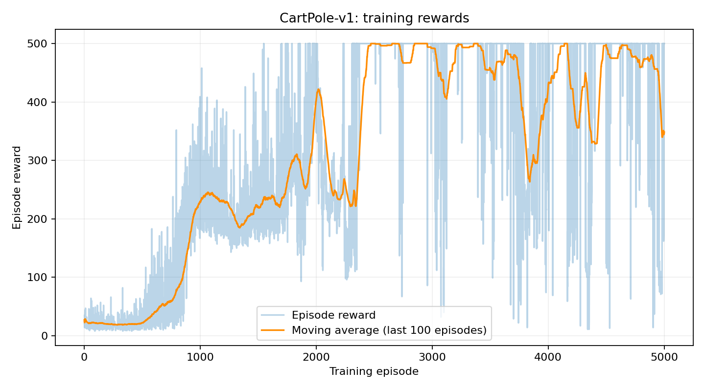
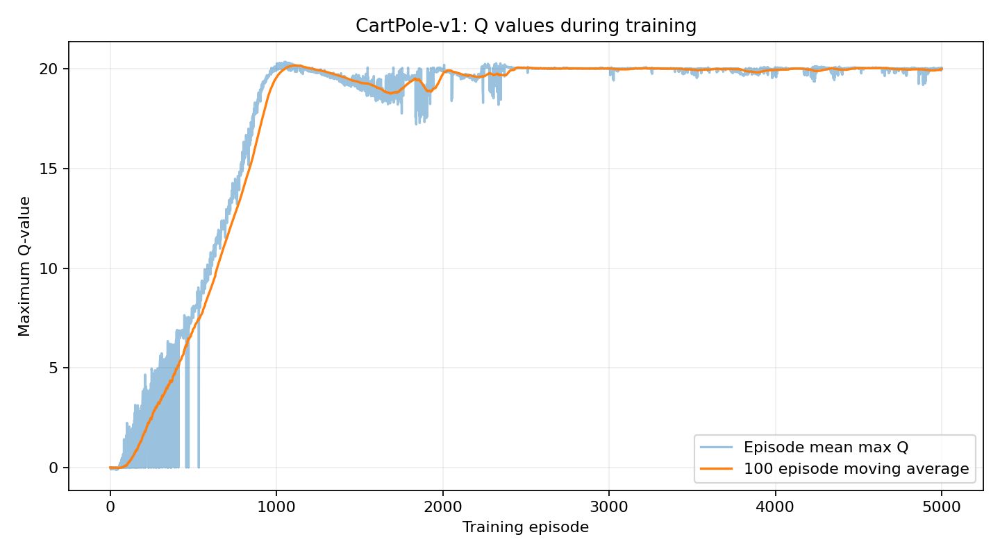
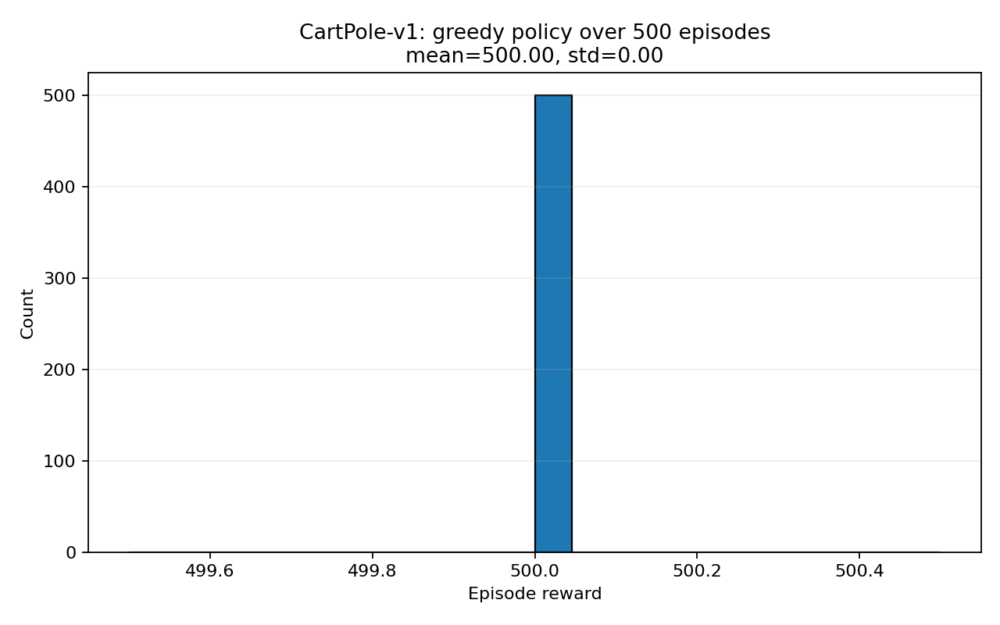
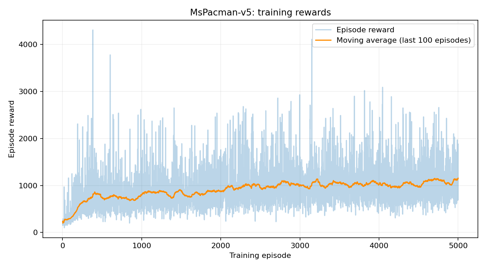
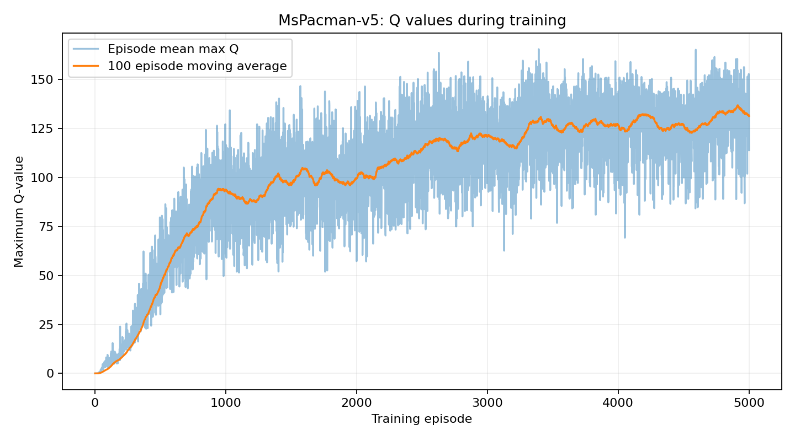
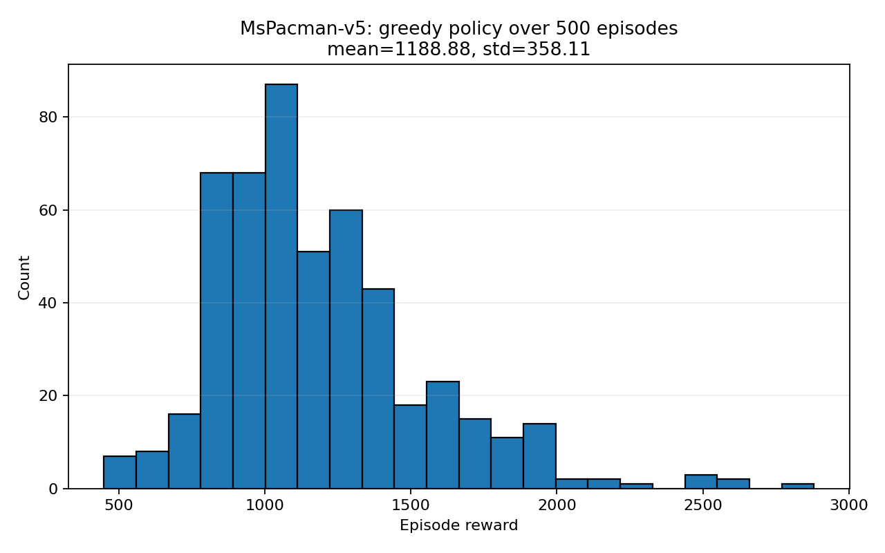
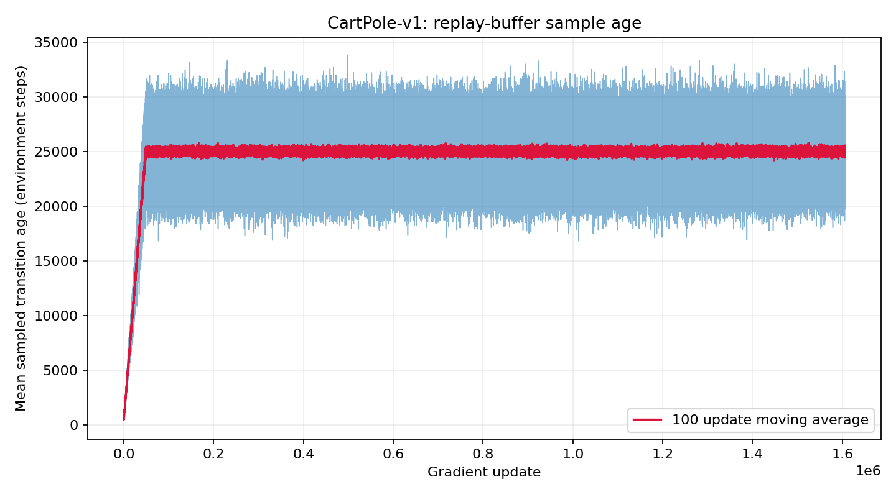
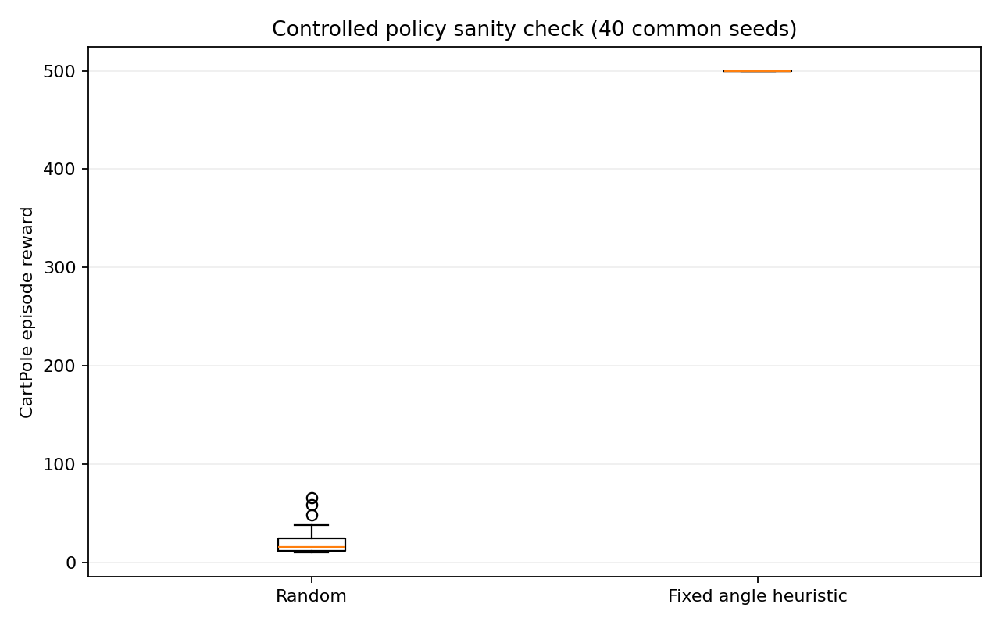

# MLDS Assignment 2: Deep Q-Network

## Repository information

- **GitHub username:** TODO
- **Repository name:** TODO
- **Public repository URL:** TODO — replace this with the public GitHub URL before submitting.
- **Training environment:** Northwestern Quest, one GPU per training job

## Overview

This project implements Deep Q-Network (DQN) agents for `CartPole-v1` and `MsPacman-v5`. The agents use neural Q-functions, experience replay, a target network, Huber loss, and gradient clipping. The CartPole agent uses a multilayer perceptron. The MsPacman agent uses a convolutional neural network and outputs Q-values for all nine actions.

MsPacman observations are cropped, downsampled, converted to grayscale, and stored as 88 × 80 `int8` images. Image transitions are stored as `uint8` in the replay buffer to reduce memory use.

## Results

| Environment | Training | Evaluation episodes | Mean reward | Standard deviation |
|---|---:|---:|---:|---:|
| CartPole-v1 | 5,000-episode hyperparameter sweep; selected checkpoint | 500 | 500.00 | 0.00 |
| MsPacman-v5 | 5,000 episodes | 500 | 1,188.88 | 358.11 |

### CartPole-v1

The required discount factor was 0.95. I compared eight configurations using four learning rates (`2e-5`, `5e-5`, `1e-4`, `2e-4`) and two epsilon-decay lengths (50,000 and 150,000 environment steps). Other settings were held fixed: batch size 64, replay capacity 50,000, 1,000 learning-start steps, and target-network update every 1,000 gradient updates. Several configurations reached the 500-point ceiling on the 20-episode validation set. I selected the `2e-5` learning rate and 50,000-step epsilon decay, then evaluated that checkpoint on 500 separate seeds. Every evaluation episode reached the 500-step limit.

CartPole gives one reward per environment step. A return of 500 means the pole remained balanced until the environment's 500-step time limit. The reported `500.00 ± 0.00` is the mean and sample standard deviation across 500 evaluation episodes.

**Selected configuration:** gamma=0.95, learning rate=2e-5, batch size=64, replay capacity=50,000, learning starts=1,000, target update=1,000, epsilon from 1.0 to 0.05 over 50,000 steps, seed=123.







### MsPacman-v5

The required discount factor was 0.99. The agent received the assignment-prescribed 88 × 80 preprocessed image and used nine actions. Training ran for 5,000 episodes with learning rate `1e-4`, batch size 32, replay capacity 50,000, 10,000 learning-start steps, target-network update every 1,000 gradient updates, and epsilon decaying from 1.0 to 0.1 over 100,000 environment steps.

The mean reward over the first 100 training episodes was 300.3; over the final 100 episodes it was 1,153.9, showing improvement during training. On 500 greedy evaluation episodes using a separate seed range, the mean reward was 1,188.88 with standard deviation 358.11. The standard deviation is large, so scores vary substantially across episodes.







## Additional diagnostic plot

The replay-sample-age plot shows how old sampled transitions are relative to the current environment step. It helps interpret replay-buffer behavior: a larger age means an update is learning from older experience, while a smaller age means samples are more recent.



## Validation and edge cases

Run the built-in validation mode from the repository root:

```bash
./.conda_env/bin/python dqn_assignment_validated.py --validate --seed 2026
```

The run writes `runs/validation/validation.json` and `runs/validation/policy_sanity_check.png`. The recorded results were:

| Check | Result |
|---|---:|
| MsPacman preprocessing output | shape `(88, 80, 1)`, dtype `int8` |
| Fixed-action CartPole trace reproducibility | `true` |
| Terminal Bellman target (`r=1`, `gamma=.95`, next Q=4) | `1.0` |
| Truncation Bellman target (`r=1`, `gamma=.95`, next Q=4) | `4.8` |
| Random policy, 40 common seeds | mean `20.825`, std `12.830` |
| Fixed angle heuristic, 40 common seeds | mean `500.0`, std `0.0` |



The validation checks also cover Gymnasium reset/step API variations, terminal versus time-limit truncation behavior, replay-buffer warm-up, the MsPacman preprocessing contract, and the expected nine-action MsPacman action space. A terminal transition does not bootstrap from the next state; a time-limit truncation still bootstraps because it is not necessarily terminal in the underlying MDP.

## Reproducing the experiments

Run these commands from the repository root on Quest. Create `logs/` before submitting jobs because Slurm opens its output files before the job script starts.

```bash
module purge
module load anaconda3/2022.05
source /software/anaconda3/2022.05/etc/profile.d/conda.sh
unset PYTHONPATH PYTHONHOME
export PYTHONNOUSERSITE=1
conda activate "$PWD/.conda_env"
```

Run validation:

```bash
./.conda_env/bin/python dqn_assignment_validated.py --validate --seed 2026
```

Submit training jobs:

```bash
mkdir -p logs
sbatch run_cartpole_grid.slurm
sbatch run_mspacman.slurm
```

Summarize the CartPole hyperparameter sweep:

```bash
./.conda_env/bin/python summarize_cartpole_grid.py
```

For final evaluation, `run_evaluation.slurm` should call `dqn_assignment_validated.py` so it can load checkpoints containing validation configuration fields. The evaluation script accepts the environment, checkpoint, seed, and output directory in that order:

```bash
sbatch run_evaluation.slurm CartPole-v1 \
  runs/cartpole_grid/lr0.00002_eps50000_seed123/best_eval_model.pt \
  200000 runs/cartpole_grid/final_eval_lr2e-5_eps50000

sbatch run_evaluation.slurm MsPacman-v5 \
  runs/mspacman_grid/seed42/best_model.pt \
  200000 runs/mspacman_grid/seed42/eval500
```

The evaluation function runs 500 greedy episodes, using the provided seed for the first episode and incrementing it for each subsequent episode.

## Further experiments with three additional months

I would run each promising configuration with multiple independent training seeds and report confidence intervals. I would also run controlled ablations for replay capacity, learning-start length, epsilon schedule, target-update interval, and Double DQN targets. Further comparisons could include uniform versus prioritized replay and smaller versus larger Atari networks. For MsPacman, I would compare learning curves at fixed environment-step budgets and report score distributions across multiple held-out seed sets. These experiments would distinguish consistent improvements from run-to-run variation.

## Figures

All figures above link directly to PNGs generated in the experiment output folders under `runs/`. Keep the `runs/` directory structure and commit the referenced PNGs with this README so that the images render in the repository viewer.

## Submission checklist

- Replace the GitHub username, repository name, and public URL at the top.
- Commit the source code, Slurm scripts, this README, and the referenced result PNGs under `runs/`.
- Export this report to PDF and submit the PDF to Canvas if the assignment requires a PDF report.
